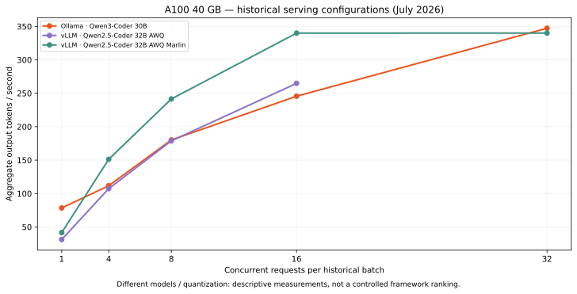

# GPU inference benchmarks

[](https://github.com/andresrubiop/gpu-inference-benchmarks/actions/workflows/tests.yml)
[](LICENSE)

**Measure LLM inference as a system:** concurrency, response latency, time to first visible content, aggregate output throughput, GPU memory and power.

This repository pairs a small, dependency-free Python benchmark client with a curated numerical record from a **July 2026 NVIDIA A100-SXM4-40GB campaign**. The client supports Ollama's streaming API and vLLM's OpenAI-compatible completions API. Historical measurements are clearly separated from tests of the new client.



The plotted configurations use different models/quantization settings. The figure describes individual runs, **not a controlled ranking of serving frameworks**. See [methodology and provenance](docs/methodology.md).

## Run a benchmark

Python 3.10+ and a separately running inference server are sufficient. No model is installed or downloaded by this repository.

```bash
git clone https://github.com/andresrubiop/gpu-inference-benchmarks.git
cd gpu-inference-benchmarks
python3 bench.py --backend ollama --model YOUR_INSTALLED_MODEL \
  --concurrency 1,4,8 --requests 32 --context 4096 \
  --output results/run-ollama.json

python3 bench.py --backend vllm --model YOUR_SERVED_MODEL \
  --base-url http://127.0.0.1:8000 --concurrency 1,4,8 \
  --output results/run-vllm.json
```

Use `--prompt-file` for an authorized input. Reports store its SHA-256, not the prompt or generated content. If a server requires authentication, set `BENCH_API_KEY` in your environment; it is never written to a report. CLI endpoints must be HTTP(S) origins without credentials in the URL.

In another terminal, sample the selected GPU:

```bash
python3 monitor_gpu.py --gpu 0 --samples 120 --interval 1 --output results/gpu.csv
```

## What the numbers mean

- Each concurrency level uses a fixed-size worker pool to process `--requests` total requests. This is closed-loop load, not a Poisson arrival process.
- Warmup requests are excluded. Keep the model, prompt, tokenizer, output limit, cache policy and server settings fixed for comparisons.
- Aggregate throughput is the successful requests' server-reported output-token count divided by **the entire measured level's wall time**, including failed requests. Missing usage stays unknown; characters are not converted into invented token counts.
- `first_content_s` measures the first non-empty streamed text chunk observed by the client. It includes transport/buffering and is not a hardware timestamp. Reasoning-only chunks are not counted as visible content.
- Latency percentiles use linear interpolation over successful requests. Failures and incomplete streams are counted separately; a run with failures exits nonzero.
- GPU CSVs are sampled observations. They are not calibrated wall-plug energy measurements, and separate GPU jobs may affect them.

## Reproduce the tooling checks

```bash
python3 -m unittest discover -s tests -v
```

Tests exercise real loopback HTTP transport with synthetic Ollama/SSE responses, incomplete streams, unknown token usage and throughput aggregation. They need neither a GPU nor a model and do not validate a serving framework's speed.

The historical summaries retain numeric fields and source hashes; prompts, generated responses, hostnames and institutional documents are excluded. The scripts are a new portable implementation inspired by that campaign, not a claim that the old A100 measurements were produced with this exact client.

By [Andrés Rubio Proaño](https://www.andresrubiop.com). Original measurement campaign: Andrés Rubio and Joel Morales, using CEDIA compute resources. Code is MIT-licensed; attribution and data provenance are documented in [methodology](docs/methodology.md).
